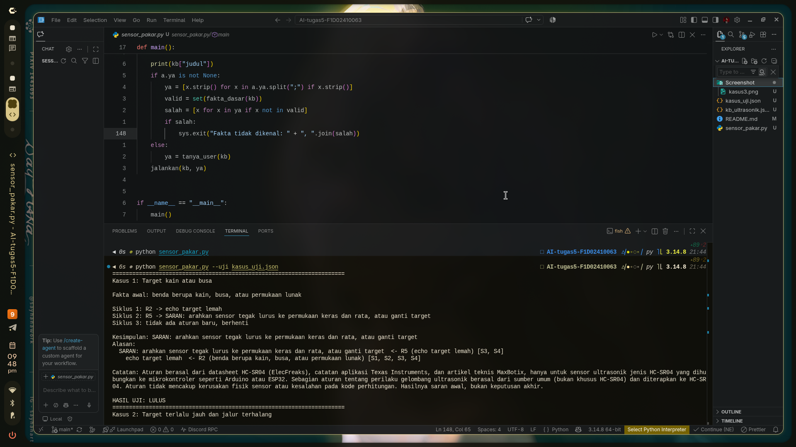
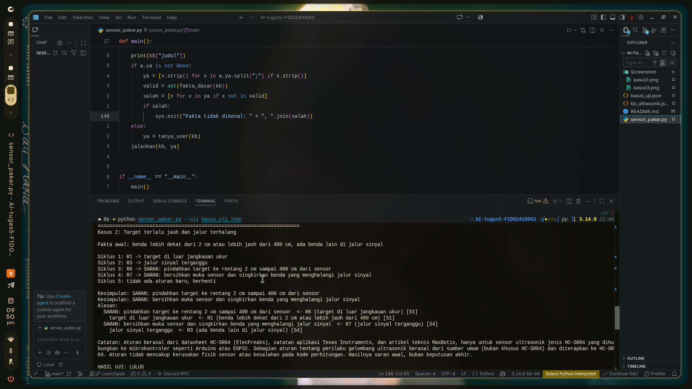
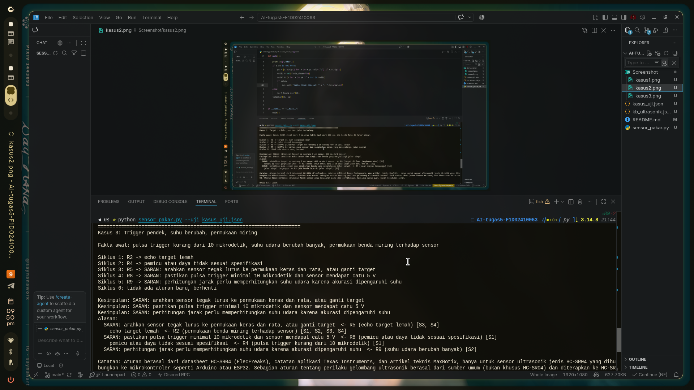

# Tugas 5 Kecerdasan Buatan: Sistem Pakar Sederhana

**Nama:** LALU ADITYA RAMADHANI
**NIM:** F1D02410063

## 1. Topik dan Cara Menjalankan

**Topik:** Penyebab bacaan jarak sensor ultrasonik HC-SR04 salah atau tidak stabil (Arduino/ESP32).

**Bahasa:** Python 3.12 (diuji pada 3.12.3). Tanpa library tambahan, hanya modul bawaan `json`, `argparse`, `sys`.

```bash
# mode tanya-jawab (y/t)
python sensor_pakar.py

# langsung beri fakta "ya" (dipisah titik koma)
python sensor_pakar.py --ya "permukaan benda miring terhadap sensor"

# jalankan semua kasus uji otomatis
python sensor_pakar.py --uji kasus_uji.json
```

Berkas: `kb_ultrasonik.json` (basis aturan), `sensor_pakar.py` (mesin forward chaining), `kasus_uji.json` (kasus uji).

## 2. Sumber dan Aturan

### Sumber

| Kode | Judul | Penerbit | URL | Diakses |
|---|---|---|---|---|
| S1 | Ultrasonic Ranging Module HC-SR04 Datasheet (terbit sekitar Maret 2020) | ElecFreaks | https://www.radiolocman.com/datasheet/pdf.html?di=168043 | 14 Nov 2026 |
| S2 | Ultrasonic sensors: Advantages and Limitations | MaxBotix Inc. | https://maxbotix.com/blogs/blog/advantages-limitations-ultrasonic-sensors | 14 Nov 2026 |
| S3 | Application note SLAA907 (dasar sensor ultrasonik) | Texas Instruments | https://ti.com/document-viewer/lit/html/SLAA907 | 14 Nov 2026 |
| S4 | What Affects Ultrasonic Tank Sensor Accuracy? | MaxBotix Inc. | https://maxbotix.com/blogs/blog/what-affects-ultrasonic-tank-sensor-accuracy | 14 Nov 2026 |

### Tabel aturan

| Aturan | IF | THEN | Sumber |
|---|---|---|---|
| R1 | benda lebih dekat dari 2 cm atau lebih jauh dari 400 cm | target di luar jangkauan ukur | S1 |
| R2 | benda lunak (kain/busa) OR permukaan miring OR benda di luar sudut sekitar 15 derajat | echo target lemah | S1, S2, S3, S4 |
| R3 | ada benda lain di jalur sinyal OR muka sensor kotor/berembun | jalur sinyal terganggu | S4 |
| R4 | pulsa trigger < 10 mikrodetik OR tegangan suplai bukan 5 V | pemicu atau daya tidak sesuai spesifikasi | S1 |
| R5 | echo target lemah | SARAN: arahkan sensor tegak lurus ke permukaan keras dan rata, atau ganti target | S3, S4 |
| R6 | target di luar jangkauan ukur | SARAN: pindahkan target ke rentang 2-400 cm | S1 |
| R7 | jalur sinyal terganggu | SARAN: bersihkan muka sensor dan singkirkan penghalang | S4 |
| R8 | pemicu atau daya tidak sesuai spesifikasi | SARAN: pastikan trigger minimal 10 mikrodetik dan catu 5 V | S1 |
| R9 | suhu udara berubah banyak | SARAN: perhitungan jarak perlu memperhitungkan suhu udara | S2 |

Ada 5 kesimpulan akhir (R5 sampai R9). R1 sampai R4 menghasilkan fakta perantara yang dipakai R5 sampai R8, jadi hasil satu aturan dipakai aturan lain.

## 3. Metode: Forward Chaining

Forward chaining dipilih karena pengguna sudah tahu kondisi pemasangan dan target sensornya, lalu ingin tahu semua kemungkinan penyebab dan saran yang berlaku. Mesin ditulis sendiri di `sensor_pakar.py`.

Langkah:
1. `memori` diisi fakta yang dijawab "ya" oleh pengguna.
2. Cari aturan yang syaratnya terpenuhi (mode `dan`: semua syarat ada; mode `atau`: salah satu cukup) dan hasilnya belum ada di memori.
3. Jika tidak ada, berhenti. Jika ada, ambil aturan pertama, tambahkan hasilnya ke memori, dan catat aturan asalnya (untuk alasan).
4. Ulangi dari langkah 2.

Aturan yang hasilnya sudah ada di memori tidak dijalankan lagi, sehingga program pasti berhenti.

## 4. Kasus Uji

| # | Jawaban "ya" | Kesimpulan yang diharapkan |
|---|---|---|
| 1 | benda berupa kain/busa/lunak | arahkan sensor tegak lurus ke permukaan keras dan rata |
| 2 | benda di luar 2-400 cm, ada benda di jalur sinyal | pindahkan target ke 2-400 cm; bersihkan jalur sinyal |
| 3 | trigger < 10 mikrodetik, suhu berubah banyak, permukaan miring | periksa trigger dan catu 5 V; perhitungan jarak memperhitungkan suhu; arahkan tegak lurus |
| 4 | (tidak ada) | tidak ada kesimpulan (kasus negatif) |

Semua kasus lulus (`python sensor_pakar.py --uji kasus_uji.json` -> `4/4 kasus lulus`).

### Screenshot







## 5. Batas Keberlakuan

Pengetahuan dalam sistem ini berasal dari datasheet HC-SR04 (ElecFreaks), catatan aplikasi Texas Instruments, dan artikel teknis MaxBotix, bukan dari pengalaman pribadi pembuat. Aturan berlaku untuk sensor ultrasonik HC-SR04 yang dihubungkan ke mikrokontroler seperti Arduino atau ESP32 pada kondisi umum. Sebagian aturan tentang perilaku gelombang ultrasonik berasal dari sumber umum (bukan khusus HC-SR04) dan diterapkan ke HC-SR04. Sistem ini tidak mencakup kerusakan fisik sensor atau kesalahan pada kode perhitungan jarak. Hasilnya saran awal, bukan keputusan akhir. Pernyataan ini juga ditampilkan oleh program pada setiap keluaran.

## 6. Penggunaan Alat Bantu AI

Saya menggunakan Claude (Anthropic) untuk mendiskusikan pilihan topik, mencari kandidat sumber, dan membuat draf awal aturan, file JSON, dan kode. Saya membuka dan memeriksa sendiri sumber S1 sampai S4, memverifikasi tiap aturan terhadap isinya, serta menjalankan dan menguji program. Saya dapat menjelaskan kode dan aturan ini.
